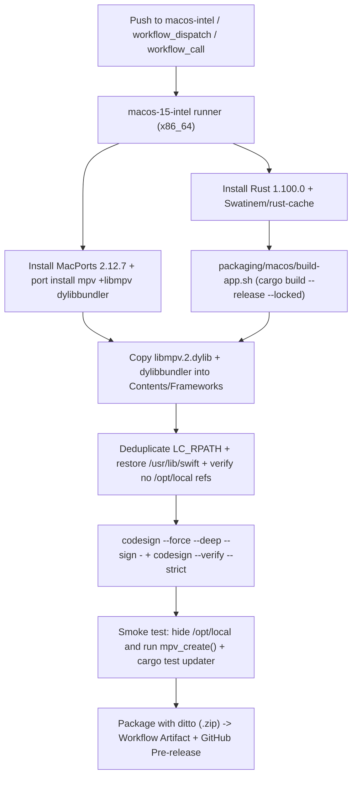

# Building & Adapting Stream Tube for macOS Intel (`x86_64`) on GitHub Actions

This document explains **what, how, and why** was done in [`DerAndr/Stream-Tube-Desktop`](https://github.com/DerAndr/Stream-Tube-Desktop) to ship a fully self-contained **Stream Tube** build for **Intel (`x86_64`) Macs**, along with the runtime issues diagnosed and fixed on real hardware (**MacBook Pro 13" 2020, `A2251` / `MacBookPro16,2`, 10th-Gen Intel Core + Intel Iris Plus, macOS 26 Tahoe**).

- **Intel releases:** [`DerAndr/Stream-Tube-Desktop/releases`](https://github.com/DerAndr/Stream-Tube-Desktop/releases) (`StreamTube-<version>-macos-x86_64-UNOFFICIAL.zip`)
- **Build workflow:** [`.github/workflows/macos-intel.yml`](../.github/workflows/macos-intel.yml)
- **Automated upstream sync workflow:** [`.github/workflows/sync-upstream.yml`](../.github/workflows/sync-upstream.yml)
- **Playback & self-updater changes:** [`src/updater_intel.rs`](../src/updater_intel.rs), [`src/updater.rs`](../src/updater.rs) (playback fixes merged upstream in [#244](https://github.com/Avaneesh-Inamdar/Stream-Tube-Desktop/pull/244) & [#245](https://github.com/Avaneesh-Inamdar/Stream-Tube-Desktop/pull/245))

---

## 1. Background: Why Upstream Did Not Run on Intel Macs

1. **Upstream `main`** targets Windows and Linux only.
2. The upstream community branch [`community/macos-apple-silicon`](https://github.com/Avaneesh-Inamdar/Stream-Tube-Desktop/tree/community/macos-apple-silicon) adds a native macOS port (GPUI Metal UI + zero-copy `OpenGL → IOSurface` video rendering), but:
   - [`.github/workflows/macos.yml`](../.github/workflows/macos.yml) builds exclusively on `macos-26` (`arm64`) runners and asserts `lipo -archs ... = arm64` (`arm64` binaries cannot run on Intel Macs — Rosetta 2 only translates in the opposite direction);
   - the upstream `.app` bundle does **not** ship `libmpv` and expects the user to run `brew install mpv` locally.
3. Fortunately, [`packaging/macos/build-app.sh`](../packaging/macos/build-app.sh) and [`src/macos.rs`](../src/macos.rs) were already written in an architecture-neutral way (`uname -m`, `/opt/homebrew` on `aarch64` vs. `/usr/local` on `x86_64`).

---

## 2. Obstacle #1: Homebrew Dropped Pre-Built `x86_64` Bottles

Running `brew install mpv` on an Intel Mac now fails out of the box:

- As of September 2026, Homebrew moved `macOS x86_64` to **Tier 3** (unsupported) and stopped publishing pre-built binary bottles for Intel Macs.
- `brew install mpv` therefore attempts to compile the entire dependency graph from source (`ffmpeg`, `libplacebo`, `yt-dlp` → `deno`), and `deno` requires a full **Xcode.app** installation rather than Command Line Tools.

### Solution: MacPorts Binary Archives in CI + Bundling `libmpv` Inside `.app`

- Instead of requiring users to install `mpv` locally, `libmpv.2.dylib` and its transitive runtime libraries (~38 MB) are bundled directly inside `Stream Tube.app/Contents/Frameworks/`.
- Stream Tube's dynamic loader ([`src/player/mpv.rs`](../src/player/mpv.rs)) already checks `../Frameworks/libmpv.2.dylib` relative to the executable **before** any Homebrew or system path, so no loader path changes were needed.
- On the `macos-15-intel` GitHub Actions runner, **MacPorts** (`MacPorts-2.12.7-15-Sequoia.pkg`) is used as the binary package source because MacPorts still publishes pre-built `x86_64` binary archives for `mpv +libmpv` and `FFmpeg` (installing all ~100 dependencies in ~3.5 minutes instead of compiling from source).

---

## 3. Obstacle #2: Duplicate `LC_RPATH` Commands & Missing Swift Runtime After `dylibbundler`

`dylibbundler` copies `libmpv.2.dylib` and every non-system `.dylib` from `/opt/local/lib` into `Stream Tube.app/Contents/Frameworks` and rewrites load commands to `@loader_path/`:

```bash
cp -L /opt/local/lib/libmpv.2.dylib "$fw/"
install_name_tool -id @loader_path/libmpv.2.dylib "$fw/libmpv.2.dylib"
dylibbundler -of -b -x "$fw/libmpv.2.dylib" -d "$fw" -p @loader_path/
```

Testing the resulting bundle uncovered two strict `dyld` behaviors on modern macOS:

1. **`duplicate LC_RPATH '@loader_path/'` rejection:** MacPorts' `libmpv.2.dylib` carries two Swift runtime rpaths (`/Applications/Xcode.app/.../usr/lib/swift/macosx` and `/usr/lib/swift`). `dylibbundler` rewrites **both** to `@loader_path/`, and macOS's `dyld` refuses to load any Mach-O binary containing duplicate `LC_RPATH` entries during `dlopen()`.
2. **Missing `/usr/lib/swift`:** rewriting `/usr/lib/swift` removed the search path needed for macOS's system Swift runtime libraries linked by `libmpv`.

### Solution in CI

After running `dylibbundler`, the workflow:
1. Scans every `.dylib` in `Contents/Frameworks` via `otool -l` and removes duplicate `LC_RPATH` entries with `install_name_tool -delete_rpath`.
2. Restores `/usr/lib/swift` on `libmpv.2.dylib` via `install_name_tool -add_rpath /usr/lib/swift`.
3. Verifies zero remaining `/opt/local` references across all bundled libraries (`otool -L "$fw"/*.dylib | grep '/opt/local'`).
4. Re-signs the entire `.app` bundle ad-hoc (`codesign --force --deep --sign -`) and validates it (`codesign --verify --deep --strict`).
5. **Runs an isolated runtime smoke test:** temporarily hides `/opt/local` (`sudo mv /opt/local /opt/local.hidden`) and loads `Contents/Frameworks/libmpv.2.dylib` via `/usr/bin/python3` (`ctypes.CDLL`), asserting both `mpv_client_api_version()` and `mpv_create()` succeed without MacPorts present on disk.

---

## 4. Obstacle #3: Playback Hang on Intel Iris Plus (`VideoToolbox` VP9 Deadlock)

When tested on a real **MacBook Pro 13" 2020 (`MacBookPro16,2`, Intel Iris Plus, macOS 26.6.2)**, the GPUI Metal UI and home feed ran smoothly, but opening or switching YouTube videos froze the entire application window (beachball).

### Root-Cause Diagnosis

Inspecting macOS system `.hang` stackshots (`/Library/Logs/DiagnosticReports/streamtube_*.hang`) and building a minimal standalone C + CGL OpenGL reproducer against `libmpv.2.dylib` pinpointed a two-part deadlock:

1. Stream Tube defaults to `codec_pref = "vp9"` (1080p) and starts `libmpv` on macOS with `hwdec=videotoolbox` (where `hwdec-codecs` defaults to `all`).
2. On Intel Ice Lake (`Intel Iris Plus`), FFmpeg's frame-threaded VP9 decoder (`av:vp9:df0..df3` in `libavcodec`) deadlocks inside Apple's `VideoToolbox` framework on real YouTube 1080p VP9 streams:
   ```text
   VTDecompressionSessionWaitForAsynchronousFrames + 341 (VideoToolbox)
     FigSemaphoreWaitRelative + 139 (CoreMedia)
       WaitOnConditionTimed + 119 (CoreMedia)
   ```
3. While waiting on `libavcodec`, `mpv`'s `core` thread holds `mp_dispatch_lock`.
4. The macOS main UI thread (`com.apple.main-thread`) called synchronous `mpv_set_property` / `mpv_set_property_string` (`Player::toggle_pause` → `Mpv::set_flag`, or `Player::load_current` → `Mpv::set("vid", "auto")`), blocking indefinitely on `mp_dispatch_lock` and freezing the Cocoa event loop.

Testing against the exact YouTube stream (`2Tp9lBaj7W8`, format `248` — 1080p VP9) in the C OpenGL harness confirmed:
- `hwdec=videotoolbox` + `hwdec-codecs=all` → deterministic hang (`SIGALRM` timeout);
- `hwdec=videotoolbox` + `hwdec-codecs=h264,hevc` → clean frame rendering and teardown, while H.264 streams continue reporting `hwdec-current=videotoolbox`.

### Two-Part Fix in Rust

1. **Restrict `VideoToolbox` hardware decode to `H.264/HEVC` on `x86_64` macOS ([`src/player/controller.rs`](../src/player/controller.rs)) — [upstream PR #245](https://github.com/Avaneesh-Inamdar/Stream-Tube-Desktop/pull/245):**
   ```rust
   #[cfg(all(target_os = "macos", target_arch = "x86_64"))]
   opts_owned.push(("hwdec-codecs".into(), "h264,hevc".into()));
   ```
   - **H.264 / HEVC** streams keep full zero-copy `VideoToolbox` hardware decoding.
   - **VP9 / AV1** streams decode on the multi-core CPU (`ff-vp9` / `dav1d`) and **still render through the zero-copy `OpenGL → IOSurface (420f) → Metal` GPU pipeline** without copying frame bytes through system RAM in GPUI.

2. **Asynchronous `mpv` property updates ([`src/player/mpv.rs`](../src/player/mpv.rs)) — [upstream PR #244](https://github.com/Avaneesh-Inamdar/Stream-Tube-Desktop/pull/244):**
   `Mpv::set`, `Mpv::set_f64`, and `Mpv::set_flag` now call `mpv_set_property_async` instead of synchronous `mpv_set_property` / `mpv_set_property_string`, matching `Mpv::command` (`mpv_command_async`). Updates enter the same FIFO dispatch queue in order without ever blocking the UI thread on `mp_dispatch_lock`.

---

## 5. GitHub Actions Build Pipeline Architecture

Workflow file: [`.github/workflows/macos-intel.yml`](../.github/workflows/macos-intel.yml)



| Stage | Purpose |
|---|---|
| `runs-on: macos-15-intel` | Native `x86_64` macOS runner for compiling Rust, pulling pre-built `x86_64` MacPorts packages, and running native `dlopen`/`mpv_create` smoke tests. |
| `MACOSX_DEPLOYMENT_TARGET: "12.0"` | Keeps the compiled `streamtube` binary's minimum system target low while linking system frameworks cleanly. |
| `Swatinem/rust-cache@v2` | Caches the ~500 compiled Rust/GPUI crates across runs. |
| `packaging/macos/build-app.sh` | Upstream packaging script: compiles the release binary, generates Retina `StreamTube.icns` via `sips` + `iconutil`, and writes `Info.plist`. |
| `dylibbundler` + `LC_RPATH` fixup | Produces a standalone `.app` (~38 MB in `Contents/Frameworks`, ~72 MB zipped) with zero external runtime dependencies. |
| `ditto -c -k --sequesterRsrc --keepParent` | Preserves macOS bundle structure, symlinks, and executable permissions inside the `.zip`. |
| `gh release create intel-v<VERSION>` | Publishes (or updates) the pre-release asset with a GitHub-computed `sha256` digest used by the in-app updater. |

---

## 6. Automated Upstream Sync & One-Click In-App Self-Updater

### 6.1. Daily Upstream Sync ([`.github/workflows/sync-upstream.yml`](../.github/workflows/sync-upstream.yml))

1. Every day at `06:15 UTC` (or manually via *Actions → Sync upstream & build Intel → Run workflow*), a lightweight `ubuntu-latest` job fetches `community/macos-apple-silicon` from `Avaneesh-Inamdar/Stream-Tube-Desktop`.
2. Checks `git merge-base --is-ancestor FETCH_HEAD HEAD`:
   - if no new upstream commits exist, the check exits in ~10 seconds without starting a macOS runner;
   - if upstream has new commits, it merges them into `macos-intel`, pushes to `origin`, and **immediately invokes `macos-intel.yml` via `workflow_call`** (since pushes made with `GITHUB_TOKEN` do not trigger `on: push` workflows);
   - if a merge conflict ever occurs, it automatically opens a GitHub Issue in this repository.

### 6.2. In-App Self-Updater on macOS Intel ([`src/updater.rs`](../src/updater.rs))

Upstream only enables self-updates on Windows (`setup.exe`). In this fork, `CAN_SELF_UPDATE` is enabled for `macos` `x86_64`:

1. At startup (and via *Settings → About → Check for updates*), the app queries `DerAndr/Stream-Tube-Desktop` releases (`intel-v*` tags).
2. When a newer version is available, clicking **Update now** downloads `StreamTube-<version>-macos-x86_64-UNOFFICIAL.zip` and verifies both file size and the **SHA-256 digest** reported by the GitHub Releases API.
3. Unpacks the archive with `ditto`, clears `com.apple.quarantine`, sets `a+rX` permissions for multi-user access, and verifies `codesign --verify --deep --strict`.
4. Replaces the running `.app` bundle (silently for `admin` users, or via the standard macOS administrator prompt for non-admin users) and relaunches Stream Tube.

---

## 7. Installing on an Intel Mac (System-Wide & Without Gatekeeper Prompts)

Because builds are ad-hoc signed rather than notarised with a paid Apple Developer ID certificate, downloading the `.zip` in a browser attaches the `com.apple.quarantine` extended attribute.

To install `Stream Tube.app` into `/Applications` **for all macOS users** without Gatekeeper prompts, run in Terminal:

```bash
curl -fsSL -o /tmp/StreamTube-intel.zip \
  "https://github.com/DerAndr/Stream-Tube-Desktop/releases/download/intel-v0.7.5-alpha/StreamTube-0.7.5-alpha-macos-x86_64-UNOFFICIAL.zip"
ditto -x -k /tmp/StreamTube-intel.zip /tmp/StreamTube-out
xattr -cr "/tmp/StreamTube-out/Stream Tube.app"
sudo rm -rf "/Applications/Stream Tube.app"
sudo mv "/tmp/StreamTube-out/Stream Tube.app" "/Applications/Stream Tube.app"
sudo chown -R root:admin "/Applications/Stream Tube.app"
sudo chmod -R a+rX "/Applications/Stream Tube.app"
rm -f /tmp/StreamTube-intel.zip && rm -rf /tmp/StreamTube-out
```

*(Optional — only needed for downloading videos above 360p via the built-in download manager)* install the official universal `yt-dlp` binary:

```bash
sudo mkdir -p /usr/local/bin
sudo curl -fsSL -o /usr/local/bin/yt-dlp https://github.com/yt-dlp/yt-dlp/releases/latest/download/yt-dlp_macos
sudo chmod 755 /usr/local/bin/yt-dlp
```
